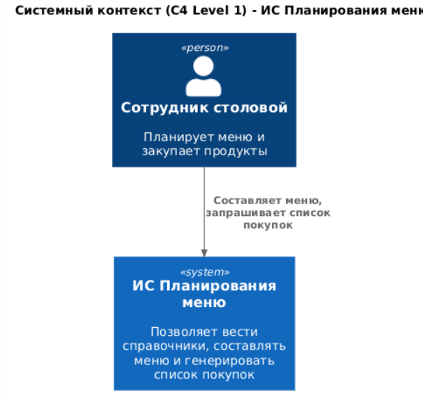
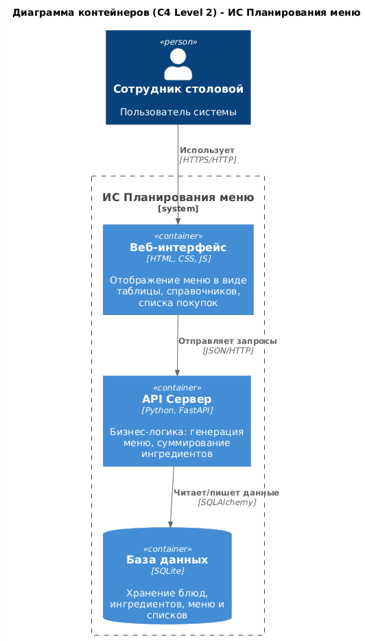
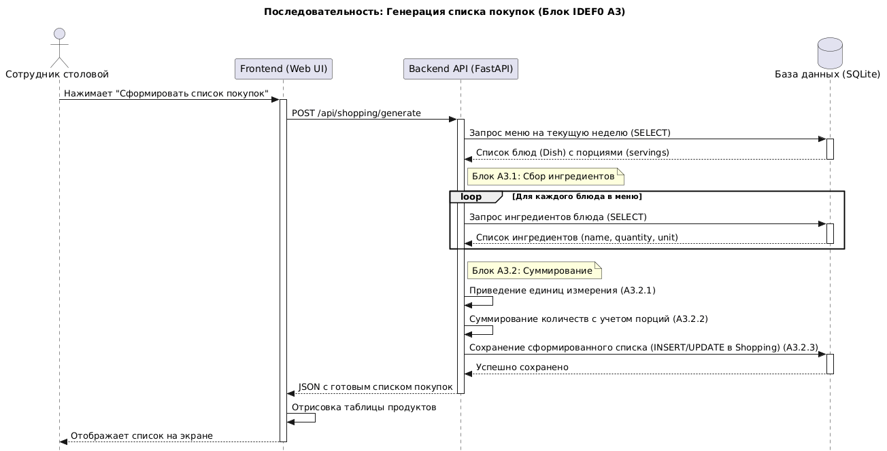
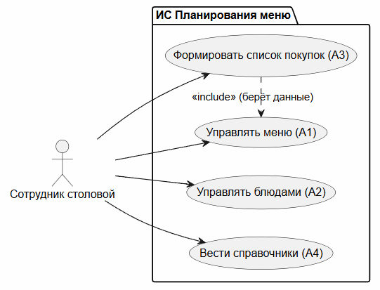
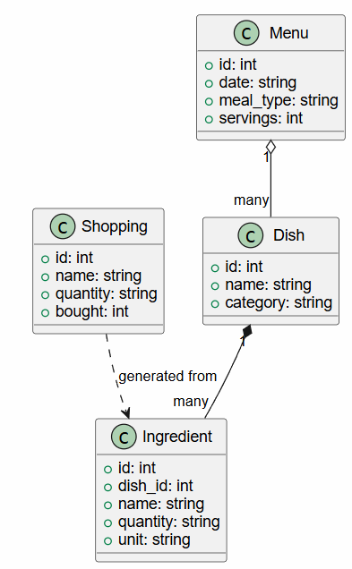

# planirovanie-menu-na-nedelu
# ИС планирования меню на неделю

Проект команды 3 курса «Прикладная информатика» по дисциплине
«Программная инженерия», 2026/2027.
Основа — индивидуальная работа А. В. Лебедева
(курс «Проектирование информационных систем»).

## Проблема и пользователи
Планирование домашнего питания на неделю ведётся вручную: пользователь
придумывает блюда, выписывает продукты, забывает ингредиенты и тратит
40–60 минут в неделю. Пользователи: студенты, сотрудники и другие люди,
ведущие домашнее хозяйство.

## Ключевые функции первого релиза
- составление меню по дням недели из базы блюд и добавление своих;
- автоматическая генерация сводного списка продуктов;
- просмотр и редактирование списка покупок;
- отметка купленных позиций;
- поиск блюд по названию и категории.

## Состав команды и роли
| Участник | Стартовая роль | GitHub |
|---|---|---|
| Николаев Игорь Олегович | тимлид | @IgrokY |
| Николаев Игорь Олегович | разработчик  | @IgrokY |
| Лебедев Александр Витальевич | аналитик | @sashalebedev1303-blip |
| Лебедев Александр Витальевич | тестировщик | @sashalebedev1303-blip |

## Как запустить

Инструкция по запуску каркаса прототипа (ЛР-5):

1. Перейдите в раздел **Releases** на странице репозитория.
2. Скачайте архив **`TastyWeek_v1.0.zip`** и распакуйте его в любую удобную папку.
3. Откройте распакованную папку проекта.
4. Перейдите по пути: `dist` → `TastyWeek` → `TastyWeek.exe`.
5. Запустите файл `TastyWeek.exe`.

> ⚠️ **Примечание:** При первом запуске Windows SmartScreen может выдать предупреждение (файл без цифровой подписи). Нажмите **«Подробнее»** → **«Выполнить в любом случае»**.

### Экспорт списка покупок (MENU-10)

Список покупок выгружается в файл прямо из приложения
(кнопка «📝 Список покупок»): **TXT** и **CSV** (Excel).
На сервере выгрузка реализована паттерном «Стратегия»:
`/api/shopping/export/strategy?format=txt|csv`. Новый формат
(например, PDF) добавляется новой стратегией без правки эндпоинта.

## Архитектура и модели 

Зафиксирована архитектура решения и построены ключевые диаграммы. Исходники (`.puml`) и экспортированные изображения находятся в директориях `docs/uml/` и `docs/architecture/`.

### Модель С4 (Уровень 1: Контекст)
Отображает систему, актора (сотрудника столовой) и границы системы.

### Модель С4 (Уровень 2: Контейнеры)
Декомпозиция системы на веб-интерфейс, API-сервер (FastAPI) и базу данных (SQLite). Выбрана монолитная архитектура (см. ADR-002).

### Диаграмма последовательностей ключевого сценария
Сценарий генерации списка покупок (отражает логику блока A3 методологии IDEF0).

### Диаграмма вариантов использования (Use-Case)

### Диаграмма классов

## Документация
- протоколы встреч: docs/protocols/;
- шаблоны: docs/templates/;
- план проекта: docs/plan/.

## План проекта

- [WBS (xlsx)](docs/plan/WBS.xlsx)
- [Диаграмма Ганта](docs/plan/Ганта_по_неделям.png)
- [Реестр рисков](docs/plan/risk.md)
- [Каталог требований](docs/plan/requirements.md)

**Текущая веха:** Демонстрация прототипа — 23.10.2026

Все задачи плана ведутся в [GitHub Issues](https://github.com/sashalebedev1303-blip/planirovanie-menu-na-nedelu/issues?q=label%3AWBS) и на [доске проекта](https://github.com/users/sashalebedev1303-blip/projects/1).

