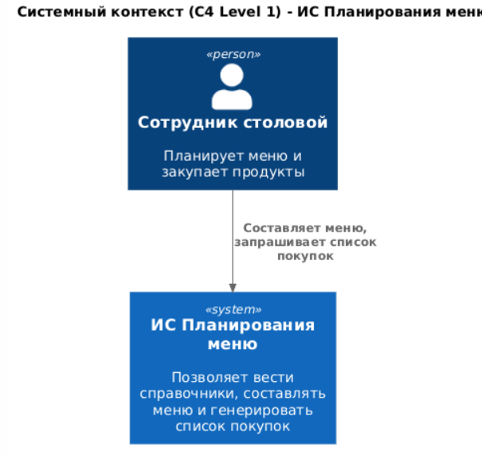
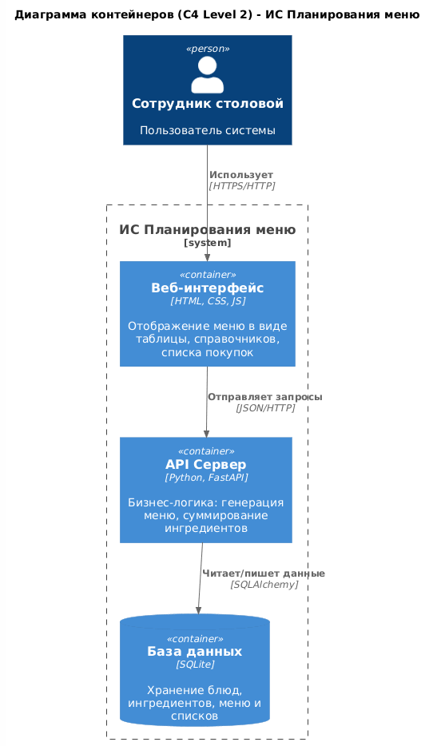
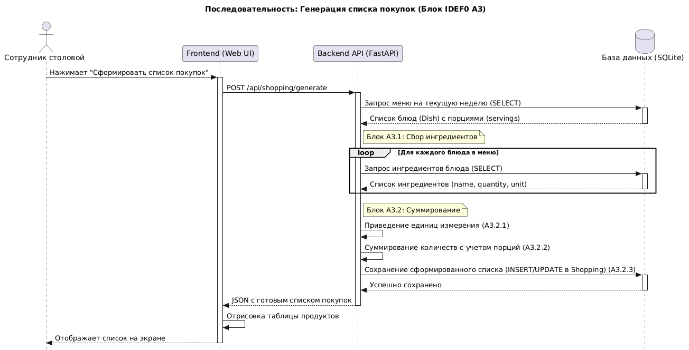
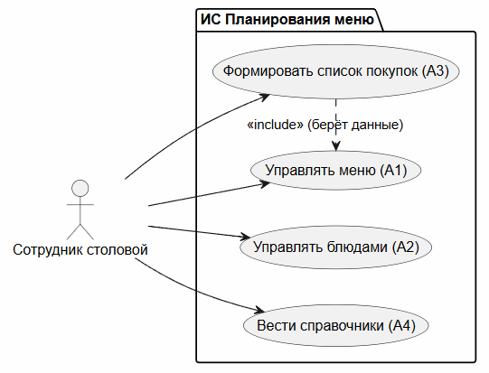
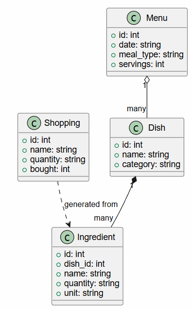

# planirovanie-menu-na-nedelu
# ИС планирования меню на неделю

Проект команды 3 курса «Прикладная информатика» по дисциплине
«Программная инженерия», 2026/2027.
Основа — индивидуальная работа А. В. Лебедева
(курс «Проектирование информационных систем»).

## Проблема и пользователи
Планирование домашнего питания на неделю ведётся вручную: пользователь
придумывает блюда, выписывает продукты, забывает ингредиенты и тратит
40–60 минут в неделю. Пользователи: студенты, сотрудники и другие люди,
ведущие домашнее хозяйство.

## Ключевые функции первого релиза
- составление меню по дням недели из базы блюд и добавление своих;
- автоматическая генерация сводного списка продуктов;
- просмотр и редактирование списка покупок;
- отметка купленных позиций;
- поиск блюд по названию и категории.

## Состав команды и роли
| Участник | Стартовая роль | GitHub |
|---|---|---|
| Николаев Игорь Олегович | тимлид | @IgrokY |
| Николаев Игорь Олегович | разработчик  | @IgrokY |
| Лебедев Александр Витальевич | аналитик | @sashalebedev1303-blip |
| Лебедев Александр Витальевич | тестировщик | @sashalebedev1303-blip |

## Как запустить

Инструкция по запуску каркаса прототипа (ЛР-5):

1. Перейдите в раздел **Releases** на странице репозитория.
2. Скачайте архив **`TastyWeek_v1.0.zip`** и распакуйте его в любую удобную папку.
3. Откройте распакованную папку проекта.
4. Перейдите по пути: `dist` → `TastyWeek` → `TastyWeek.exe`.
5. Запустите файл `TastyWeek.exe`.

> ⚠️ **Примечание:** При первом запуске Windows SmartScreen может выдать предупреждение (файл без цифровой подписи). Нажмите **«Подробнее»** → **«Выполнить в любом случае»**.

### Запуск в контейнере (ЛР-9)

Приложение упаковано в Docker-образ (`Dockerfile` в корне репозитория).
Сборка и запуск из исходников:

```
docker build -t tastyweek:v1.0.0 .
docker run --rm -p 8000:8000 -v tastyweek-data:/app/data tastyweek:v1.0.0
```

Приложение откроется на <http://localhost:8000>; база хранится в томе
`tastyweek-data`. Готовый образ публикуется в GHCR при слиянии в `main`
и при push тега:

```
docker pull ghcr.io/sashalebedev1303-blip/planirovanie-menu-na-nedelu:1.0.0
```

Параметры запуска задаются переменными окружения: `HOST` (по умолчанию
`127.0.0.1`), `PORT` (`8000`), `OPEN_BROWSER` (`1` — открыть браузер,
`0` — не открывать), `DATABASE_PATH` (путь к файлу SQLite).

## Как запустить тесты (ЛР-7)

Все автотесты запускаются одной командой из корня репозитория:

```
python -m pytest
```

Что запустится:

- модульные тесты ключевой логики (`tests/test_shopping_calc.py`,
  `tests/test_quantity.py`, `tests/test_export_strategies.py`);
- интеграционные тесты API (`tests/test_integration_api.py` — форма →
  валидация → сохранение → список покупок).

Покрытие ключевой вычислительной логики замеряется автоматически при
каждом запуске (`pytest.ini`): `shopping_calc` и `quantity`, отчёт
`term-missing`, порог зафиксирован на отметке 60%
(`--cov-fail-under=60`, фактически покрытие — 100%).

Для подробного отчёта с номерами непокрытых строк:

```
python -m pytest --cov-report=term-missing -v
```

Установка зависимостей для тестирования: `python -m pip install -r requirements-dev.txt -r src/requirements.txt`.

## Метрики качества и технический долг (ЛР-8)

Статический анализ: [](https://github.com/sashalebedev1303-blip/planirovanie-menu-na-nedelu/actions/workflows/ruff.yml)
(CI-профиль ruff, прогоны на каждом push и PR) + расширенный локальный
профиль `ruff-strict.toml` и скрипт метрик `scripts/code_metrics.py`
(SonarCloud подключается при доступе владельца — см. `docs/debt/accepted-debt.md`, О-5).

Команды локального анализа:

```
python -m ruff check src                        # CI-профиль (зелёная сборка)
python -m ruff check src --config ruff-strict.toml   # строгий профиль
python scripts/code_metrics.py src              # сложность, дубли, LOC
```

Артефакты ЛР-8:

- профиль качества: [docs/quality/profile.md](docs/quality/profile.md)
  (+ замеры `metrics-before.json` / `metrics-after.json`);
- классификация 10 замечаний по ISO/IEC 25010:
  [docs/quality/classification.md](docs/quality/classification.md);
- реестр технического долга топ-5 с отметками о погашении:
  [docs/debt/registry.md](docs/debt/registry.md);
- заметка об осознанно принятом остаточном долге:
  [docs/debt/accepted-debt.md](docs/debt/accepted-debt.md);
- сравнение метрик «до — после»:
  [docs/quality/before-after.md](docs/quality/before-after.md);
- отчёты строгого профиля ruff: [«до» — 15 замечаний](docs/quality/ruff-strict-before.txt),
  [«после» — 0](docs/quality/ruff-strict-after.txt);
- доказательство «тесты как страховка»: [лог воспроизведения дефекта db.commit()](docs/quality/defect-drill-dbcommit.txt);
- сверка анализаторов и дополнительный прогон настоящего SonarQube
  (Community Build 9.9.8 LTS в GitHub Actions):
  [docs/quality/sonarqube-comparison.md](docs/quality/sonarqube-comparison.md),
  метрики и замечания — [docs/quality/sonarqube/](docs/quality/sonarqube/README.md).

> Для подключения SonarCloud: войти на sonarcloud.io через GitHub-аккаунт
> владельца репозитория, импортировать репозиторий, добавить бейдж в
> README. Для Python-проектов настройка автоматическая; при необходимости
> сгенерировать `sonar-project.properties` (путь источников — `src`).

## Конвейер CI/CD и релиз (ЛР-9)

[](https://github.com/sashalebedev1303-blip/planirovanie-menu-na-nedelu/actions/workflows/ci.yml)

Единый конвейер — `.github/workflows/ci.yml`:

- на каждый PR в `main`: `lint` (ruff) → `tests` (pytest, 43 теста) →
  `build` (артефакт `tastyweek-app.zip`) → `docker` (сборка образа,
  `docker run` и smoke-тест `/api/menu`);
- на push в `main` и на тег `v*`: то же + публикация образа в GHCR;
- красный статус блокирует слияние после настройки защиты ветки.

Артефакты ЛР-9:

- инструкция по конвейеру и защите ветки: [docs/ci.md](docs/ci.md);
- заметки релиза v1.0.0: [docs/release-notes/v1.0.0.md](docs/release-notes/v1.0.0.md);
- демонстрация «путь изменения»: [docs/release-demo/README.md](docs/release-demo/README.md);
- презентация защиты: [docs/presentation.pptx](docs/presentation.pptx)
  ([PDF-версия](docs/presentation.pdf));
- обратная связь репетиции: [docs/feedback.md](docs/feedback.md).

Релиз: [v1.0.0](https://github.com/sashalebedev1303-blip/planirovanie-menu-na-nedelu/releases/tag/v1.0.0).
Образ: `ghcr.io/sashalebedev1303-blip/planirovanie-menu-na-nedelu:1.0.0`.

Локальные команды конвейера:

```
python -m ruff check .                 # lint
python -m pytest -v                    # tests
python scripts/build_release.py        # build (dist/tastyweek-app.zip)
docker build -t tastyweek:v1.0.0 .     # docker
```

## Архитектура и модели 

Зафиксирована архитектура решения и построены ключевые диаграммы. Исходники (`.puml`) и экспортированные изображения находятся в директориях `docs/uml/` и `docs/architecture/`.

### Модель С4 (Уровень 1: Контекст)
Отображает систему, актора (сотрудника столовой) и границы системы.


### Модель С4 (Уровень 2: Контейнеры)
Декомпозиция системы на веб-интерфейс, API-сервер (FastAPI) и базу данных (SQLite). Выбрана монолитная архитектура (см. ADR-002).


### Диаграмма последовательностей ключевого сценария
Сценарий генерации списка покупок (отражает логику блока A3 методологии IDEF0).


### Диаграмма вариантов использования (Use-Case)


### Диаграмма классов


## Документация
- протоколы встреч: docs/protocols/;
- шаблоны: docs/templates/;
- план проекта: docs/plan/.

## План проекта

- [WBS (xlsx)](docs/plan/WBS.xlsx)
- [Диаграмма Ганта](docs/plan/Ганта_по_неделям.png)
- [Реестр рисков](docs/plan/risk.md)
- [Каталог требований](docs/plan/requirements.md)

**Текущая веха:** релиз **v1.0.0** — 21.11.2026; защита сквозного проекта — зачётная неделя. Ранее: демонстрация прототипа — 23.10.2026; сданы ЛР-5 и ЛР-6 — 30.10.2026; обновление плана после ЛР-6 — 02.11.2026.

Все задачи плана ведутся в [GitHub Issues](https://github.com/sashalebedev1303-blip/planirovanie-menu-na-nedelu/issues?q=label%3AWBS) и на [доске проекта](https://github.com/users/sashalebedev1303-blip/projects/1).


