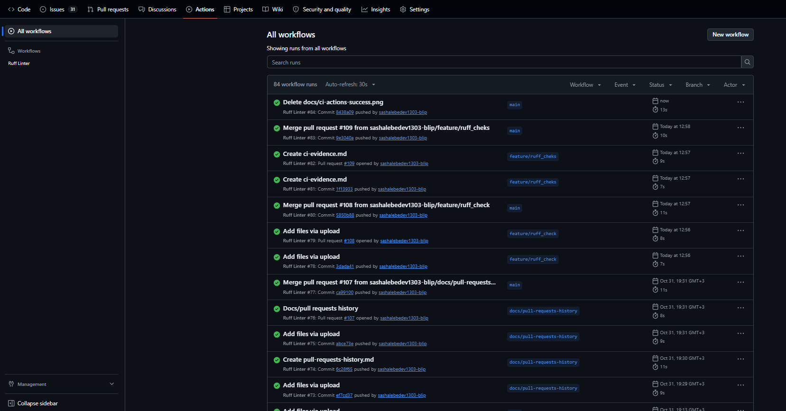

# Доказательства работы автоматических проверок (CI)

В проекте настроен пайплайн непрерывной интеграции (CI) с использованием **GitHub Actions**. 

При каждом изменении кода (Push или Pull Request) запускается робот, который использует настройки из файла `ruff.toml` и проверяет весь код линтером **Ruff**.

На скриншоте ниже видно, что все последние проверки для ветки `main` и Pull Request'ов завершились успешно (зеленые галочки). Это подтверждает, что код чист, не содержит синтаксических ошибок и соответствует стандартам PEP 8, настроенным в конфигурации.

