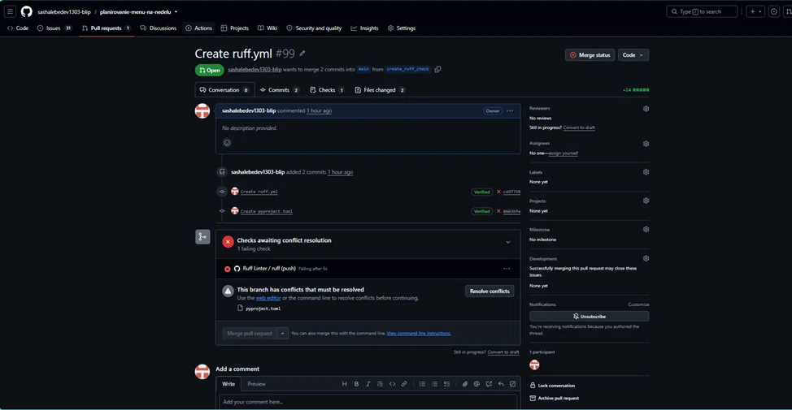

# Моделирование конфликта слияния «на двоих» (ЛР-6, шаг 7)

Сценарий дополняет [conflict-resolution.md](conflict-resolution.md): раньше конфликт
разрешался в конфиге линтера, здесь команда повторяет учебный конфликт строго по
методичке — **два участника намеренно изменяют одну и ту же строку общего файла
в разных ветках**, воспроизводят конфликт слияния и разрешают его.

- Общий файл: `README.md`, строка «**Текущая веха:** …» (одна и та же строка).
- Сторона A — [@IgrokY](https://github.com/IgrokY), ветка
  [`feature/conflict-drill-side-a`](https://github.com/sashalebedev1303-blip/planirovanie-menu-na-nedelu/tree/feature/conflict-drill-side-a)
  (правка уже внесена и закоммичена: коммит «Изменить веху в README для учебного
  конфликта слияния (сторона A, IgrokY)»).
- Сторона B — [@sashalebedev1303-blip](https://github.com/sashalebedev1303-blip),
  ветка [`feature/conflict-drill-side-b`](https://github.com/sashalebedev1303-blip/planirovanie-menu-na-nedelu/tree/feature/conflict-drill-side-b)
  — правку вносит самостоятельно по шагам ниже.

## Шаги стороны B (Лебедев, через web-интерфейс GitHub)

1. Открыть [README.md на ветке `feature/conflict-drill-side-b`](https://github.com/sashalebedev1303-blip/planirovanie-menu-na-nedelu/edit/feature/conflict-drill-side-b/README.md) (карандаш).
2. Найти строку `**Текущая веха:** Демонстрация прототипа — 23.10.2026` и заменить её на:
   `**Текущая веха:** Демонстрация прототипа — 23.10.2026; обновление плана после ЛР-6 — 02.11.2026 (сторона B).`
   (правится именно та же строка, которую уже поменял IgrokY — так и задумано).
3. Нажать **Commit changes** — коммит прямо в ветку
   `feature/conflict-drill-side-b` (утверждение: «Изменить веху для учебного конфликта (сторона B, Лебедев)»).
4. Создать PR этой ветки в `main`
   ([ссылка с автозаполнением](https://github.com/sashalebedev1303-blip/planirovanie-menu-na-nedelu/compare/main...feature/conflict-drill-side-b?expand=1)),
   заголовок «Слить правку вехи от Лебедева (сторона B учебного конфликта)».
5. Ревью PR ставит второй участник (IgrokY): **Approve**, затем PR сливается в
   `main`. Ветку не удалять до конца упражнения.

## Шаги стороны A (IgrokY, тогда конфликт воспроизводится)

6. После слияния ветки B открыть PR из ветки
   `feature/conflict-drill-side-a` в `main`
   ([ссылка](https://github.com/sashalebedev1303-blip/planirovanie-menu-na-nedelu/compare/main...feature/conflict-drill-side-a?expand=1)).
7. GitHub покажет: *«This branch has conflicts that must be resolved»* — в
   файле `README.md` возник конфликт: одна и та же строка изменена в обеих ветках.
   
8. Разрешение (кнопка **Resolve conflicts** в PR или локально `git checkout
   feature/conflict-drill-side-a && git merge main`). В файле видны маркеры:
   ```
   <<<<<<< README.md
   **Текущая веха:** … (сторона A)
   =======
   **Текущая веха:** … (сторона B)
   >>>>>>> main
   ```
9. Обсудить обе версии и зафиксировать итог — сохранить **оба** смысла одной строкой без ветвлений:
   ```
   **Текущая веха:** Демонстрация прототипа — 23.10.2026; сданы ЛР-5 и ЛР-6 — 30.10.2026; обновление плана после ЛР-6 — 02.11.2026.
   ```
10. Отметить строку как разрешённую (**Mark as resolved**), **Commit merge**, затем слить PR.
11. После слияния удалить обе временные ветки через интерфейс GitHub.
12. Скриншоты шагов 7 (маркеры конфликта), 8–9 (разрешение) приложить к
    [conflict-resolution.md](conflict-resolution.md) разделом «Дубль на двоих» —
    тогда шаг 7 методички закрыт с участием обоих участников.
