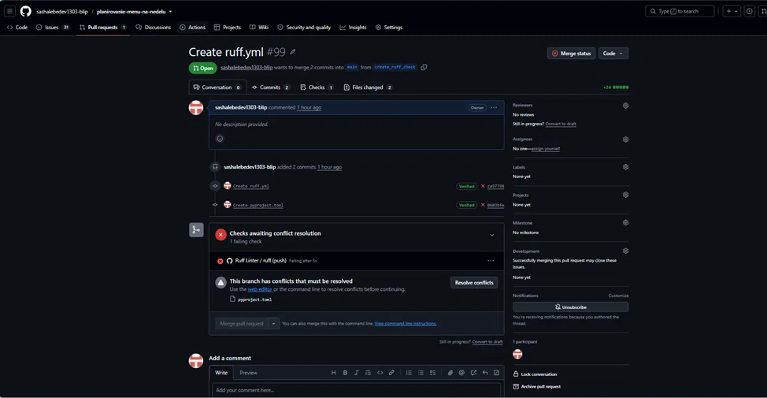
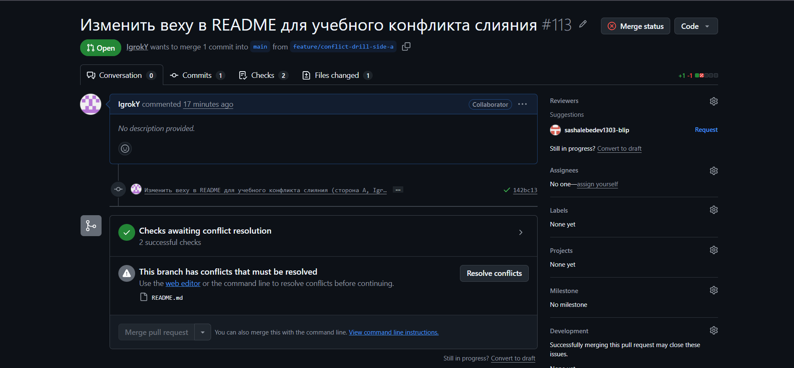
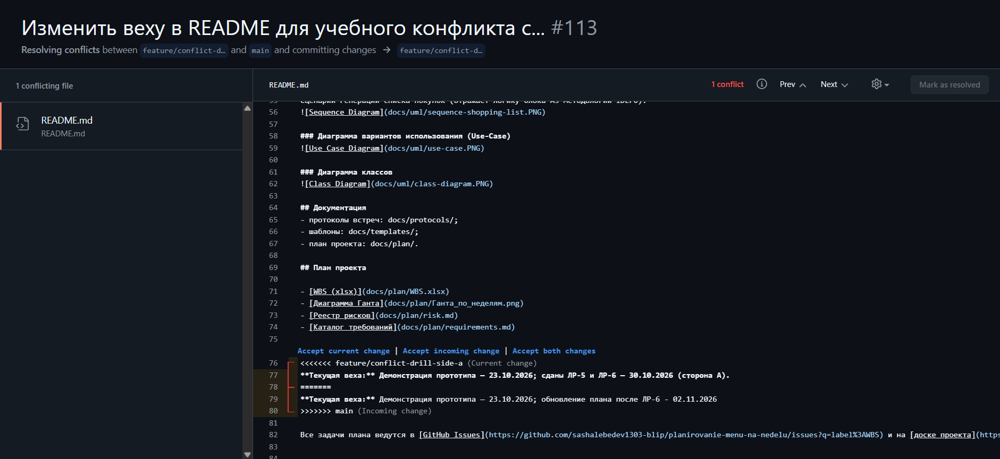
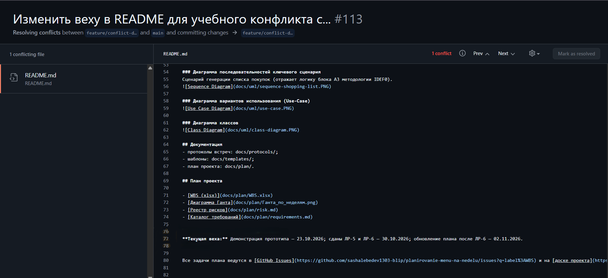

# Разрешение конфликта слияния

## Ситуация
При настройке линтера (Ruff) файл конфигурации (изначально созданный как `pyproject.toml`, но позже переименованный в `ruff.toml` согласно требованиям методички) был добавлен в ветку `main`. Одновременно с этим, для проверки кода через GitHub Actions, изменения, касающиеся этой конфигурации, были внесены в ветку `create_ruff_check`. При попытке слить ветку `create_ruff_check` в `main` через Pull Request возник конфликт версий.

## Как мы его разрешили
1. При попытке слияния GitHub выдал ошибку: *"This branch has conflicts that must be resolved"*.
2. Мы нажали кнопку **Resolve conflicts** прямо в веб-интерфейсе GitHub.
3. Открыли файл, увидели маркеры конфликта:
   `<<<<<<< create_ruff_check`
   `=======`
   `>>>>>>> main`
4. Обсудили обе версии (в одной были базовые настройки, в другой — расширенные с параметрами `ignore`), удалили маркеры и оставили единый, итоговый список правил линтера.
5. Нажали **Mark as resolved** и **Commit merge**.
6. Конфликт был успешно разрешен, автоматическая проверка (GitHub Actions) прошла успешно (зеленая галочка).

## Дубль на двоих (ЛР-6, шаг 7)

Позже команда повторила конфликт строго по методичке на другом файле: две ветки
(`feature/conflict-drill-side-a` — IgrokY и `feature/conflict-drill-side-b` — Лебедев)
модифицировали одну и ту же строку «Текущая веха» в `README.md`. Полное описание
сценария — в [conflict-resolution-drill.md](conflict-resolution-drill.md) (PR #113/#114).

1. PR из ветки A в `main` после слияния ветки B: GitHub заблокировал слияние —
   *«This branch has conflicts that must be resolved»*, конфликт в `README.md`.
   
2. Кнопка **Resolve conflicts** открыла web-редактор: видны маркеры
   `<<<<<<< feature/conflict-drill-side-a` / `=======` / `>>>>>>> main`
   и варианты выбора (Accept current / incoming / both changes).
   
3. Обе версии обсуждены и сохранены одной строкой (сданы ЛР-5 и ЛР-6 — 30.10.2026,
   обе правки вехи объединены), маркеры убраны, строка отмечена как разрешённая.
   
4. **Commit merge** → PR слит без конфликтов, CI (Ruff Linter) зелёный.
