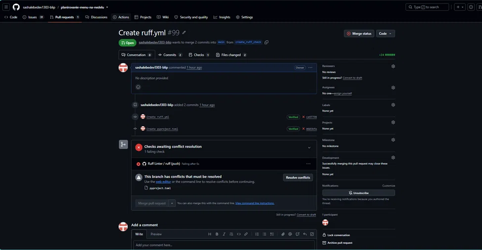

# Разрешение конфликта слияния

## Ситуация
При настройке линтера (Ruff) файл конфигурации (изначально созданный как `pyproject.toml`, но позже переименованный в `ruff.toml` согласно требованиям методички) был добавлен в ветку `main`. Одновременно с этим, для проверки кода через GitHub Actions, изменения, касающиеся этой конфигурации, были внесены в ветку `create_ruff_check`. При попытке слить ветку `create_ruff_check` в `main` через Pull Request возник конфликт версий.

## Как мы его разрешили
1. При попытке слияния GitHub выдал ошибку: *"This branch has conflicts that must be resolved"*.
2. Мы нажали кнопку **Resolve conflicts** прямо в веб-интерфейсе GitHub.
3. Открыли файл, увидели маркеры конфликта:
   `<<<<<<< create_ruff_check`
   `=======`
   `>>>>>>> main`
4. Обсудили обе версии (в одной были базовые настройки, в другой — расширенные с параметрами `ignore`), удалили маркеры и оставили единый, итоговый список правил линтера.
5. Нажали **Mark as resolved** и **Commit merge**.
6. Конфликт был успешно разрешен, автоматическая проверка (GitHub Actions) прошла успешно (зеленая галочка).

