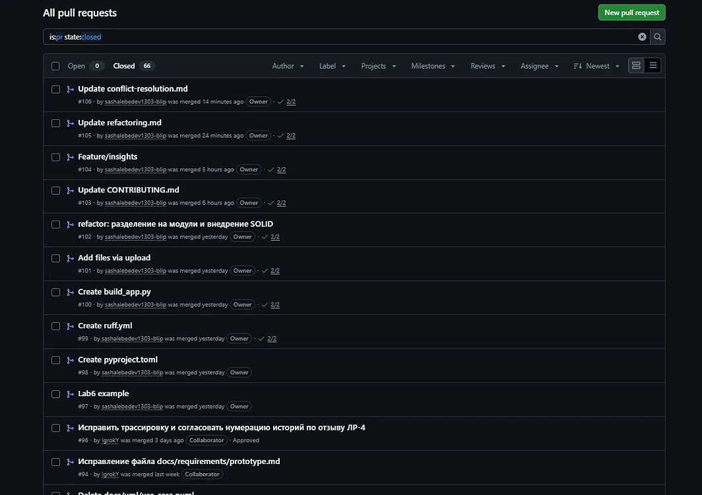

# История Pull Request (задачи участников)

В ходе выполнения лабораторной работы командой использовалась модель **GitHub Flow**. Все изменения в основную ветку `main` вносились исключительно через Pull Request (PR), которые проходили код-ревью и автоматические проверки (CI).

Ниже представлена история Pull Request по задачам участников (фильтр: Closed/Merged):

*Примечание:* Все указанные PR были успешно слиты в ветку `main` (статус **Merged**). Для PR #96 и #102 было проведено код-ревью (Approve) вторым участником команды.

## Хронология PR по задачам (обновлено до #117)

Количественная сводка по коммитам — в [team-contributions.md](team-contributions.md)
(по данным **Insights → Contributors**), здесь — детализация по PR.
Таблица заменяет устаревшую таблицу из `docs/lab6/contribution-summary.md`
(удалён как дубли с другими цифрами и данными только до #102).

| PR | Кто вёл | Что сделано |
|---|---|---|
| #99 `create_ruff_check` | Игорь | линтер ruff в CI; **конфликт** по `ruff.toml` разрешён в веб-интерфейсе (см. [conflict-resolution.md](conflict-resolution.md)) |
| #100 `create-build.app` | Лебедев | скрипт сборки `src/build_app.py` |
| #101 `new_dishes` | Лебедев | расширение справочника блюд (`src/dishes.csv` до 2373 строк) |
| #102 `feature/solid-refactoring_original` | Лебедев | SOLID-рефакторинг (слои `database.py`, `models.py`, `schemas.py`), паттерн «Стратегия», `docs/refactoring.md` |
| #103 | Лебедев | обновление правил в `CONTRIBUTING.md` |
| #104 | Лебедев | статистика участия (Insights, скриншот `team-contributions.png`) |
| #105 | Лебедев | правка отчёта `docs/refactoring.md` |
| #106 | Лебедев | правка описания конфликта `docs/conflict-resolution.md` |
| #107 | Лебедев | история PR — этот файл (`docs/pull-requests-history.md`) |
| #108 | Лебедев | загрузка иллюстраций в `docs/` |
| #109 | Лебедев | доказательство CI: `docs/ci-evidence.md`, `ci-actions-success.png` |
| #110 | Игорь | рефакторинг экспорта по SOLID (OCP): `src/export_strategies.py`, раздел «до — после» в `docs/refactoring.md` |
| #111 | Игорь | сценарий учебного конфликта (`docs/conflict-resolution-drill.md`) и чек-лист перекрёстного ревью (`docs/peer-review-checklist.md`) |
| #112 | Игорь | восстановление состояния тега v0.1.0: `tests/` (13 pytest-тестов), `src/quantity.py`, `requirements-dev.txt`, `CONTRIBUTING.md` |
| #113 | Игорь | учебный конфликт, сторона A (веха в `README.md`) |
| #114 | Лебедев | учебный конфликт, сторона B (веха в `README.md`) |
| #115 | Игорь | скриншоты конфликта в `docs/` + раздел «Дубль на двоих» в `docs/conflict-resolution.md` |
| #116–#117 | Лебедев | актуализация чек-листа ревью `docs/peer-review-checklist.md` |

Учебный конфликт (#113/#114) и разрешение конфликта через web-редактор описаны в [conflict-resolution.md](conflict-resolution.md), раздел «Дубль на двоих».

