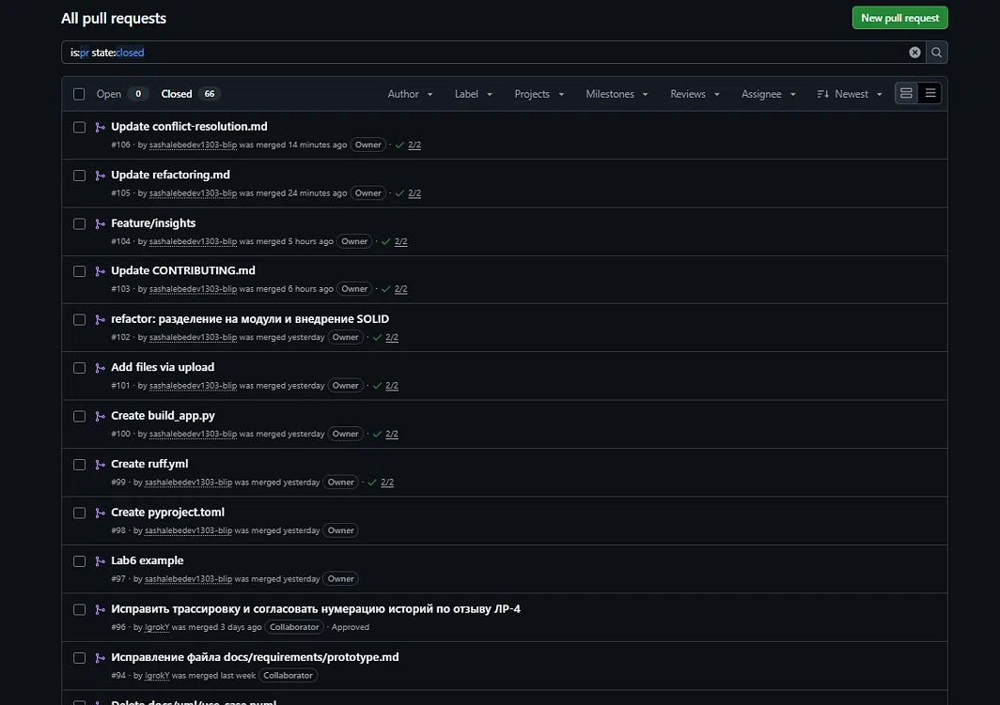

# История Pull Request (задачи участников)

В ходе выполнения лабораторной работы командой использовалась модель **GitHub Flow**. Все изменения в основную ветку `main` вносились исключительно через Pull Request (PR), которые проходили код-ревью и автоматические проверки (CI).

Ниже представлена история Pull Request по задачам участников (фильтр: Closed/Merged):

*Примечание:* Все указанные PR были успешно слиты в ветку `main` (статус **Merged**). Для PR #96 и #102 было проведено код-ревью (Approve) вторым участником команды.

