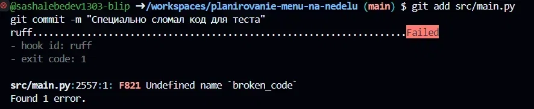
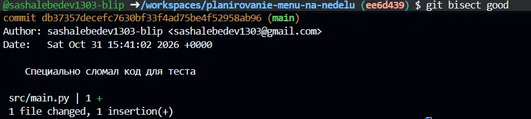

# Отчет о SOLID-рефакторинге и паттернах

## 1. Устранение нарушения SRP (Single Responsibility Principle)
**До:** В файле `main.py` находилось абсолютно всё: настройка подключения к БД, описание таблиц SQLAlchemy, Pydantic-схемы валидации, API-роуты и огромная строка с HTML-кодом. Файл имел множество причин для изменения.

**После:** Код разделен на слои. Созданы модули `database.py` (подключение), `models.py` (таблицы) и `schemas.py` (валидация). Теперь `main.py` отвечает только за маршрутизацию API-запросов. Это сделало код модульным и соответствующим принципам SOLID.

## 2. Применение паттерна «Стратегия» (Strategy)

**Где было ветвление поведения:** В приложении требовалось реализовать выгрузку списка покупок в разных форматах (TXT и CSV). Без использования паттернов это привело бы к созданию громоздкой конструкции `if/elif` внутри одной функции API, что нарушило бы принцип OCP (Open/Closed Principle).

**Обоснование выбора:** Паттерн «Стратегия» позволяет вынести каждый алгоритм (формат выгрузки) в отдельный класс, реализующий общий интерфейс `ExportStrategy`. Теперь контекст (API-роут) просто вызывает метод `export()` у нужной стратегии.

**Преимущество:** Если в будущем потребуется добавить экспорт в PDF или Excel, мы просто создадим новый класс `PdfExportStrategy`, не изменяя уже существующий код.

**Реализация:** В `src/main.py` добавлены классы `TxtExportStrategy` и `CsvExportStrategy`, а также эндпоинт `/api/shopping/export/strategy`.

## 3. Демонстрация продвинутых возможностей Git 

В рамках выполнения продвинутого уровня лабораторной работы были настроены и проверены на практике инструменты контроля качества и поиска ошибок.

### 3.1. Настройка pre-commit хука
Для предотвращения попадания ошибочного кода в репозиторий был настроен локальный `pre-commit` хук. 
1. В корне репозитория создан файл `.pre-commit-config.yaml`, который привязывает линтер Ruff к моменту коммита.
2. В терминале (среда GitHub Codespaces) выполнена установка: `pip install pre-commit` и активация: `pre-commit install`.
3. **Демонстрация работы:** 
   * При попытке закоммитить файл с намеренно внесенной ошибкой (`broken_code`), хук сработал и **заблокировал** коммит, выдав статус `Failed` с ошибкой `F821 Undefined name 'broken_code'`.
   * При коммите корректного кода хук выдал статус `Passed`. 

*(Доказательство работы pre-commit хука)*

### 3.2. Поиск дефекта с помощью Git Bisect
Для демонстрации бинарного поиска ошибки был проведен следующий эксперимент:
1. В код был намеренно внесен дефект (добавлена несуществующая переменная). Для создания «сломанного» коммита использовался флаг `--no-verify` (чтобы обойти защиту pre-commit): `git commit -m "Специально сломал код для теста" --no-verify`.
2. Запущен поиск: `git bisect start`.
3. Текущий (сломанный) коммит помечен как `bad`, а стабильный релиз — как `good`: `git bisect good v0.1.0`.
4. Git автоматически переключал ветки на промежуточные коммиты. На каждом шаге выполнялась проверка, после чего вводилась команда `git bisect good` (так как ошибка была только в самом последнем коммите).
5. Алгоритм бинарного поиска быстро сузил диапазон и нашел виновный коммит, выдав сообщение: `db37357... is the first bad commit` с комментарием `Специально сломал код для теста`.
6. После успешной демонстрации поиск был завершен командой `git bisect reset`, а сломанный коммит удален из истории с помощью `git reset --hard HEAD~1`.

*(Результат поиска виновного коммита)*

