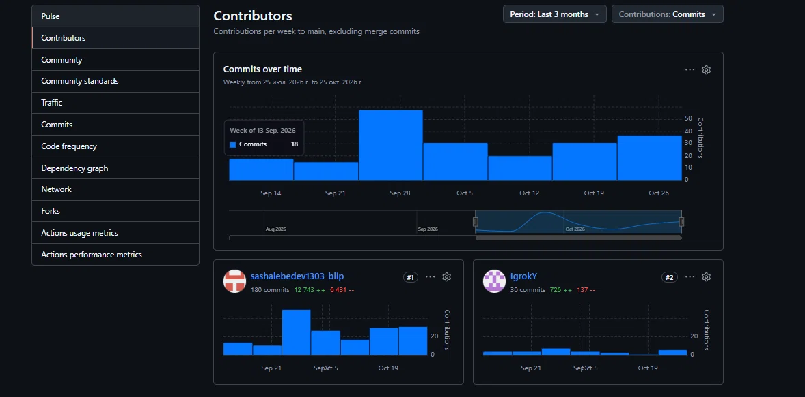

# Сводка вклада участников (GitHub Insights)

В рамках выполнения лабораторной работы №6 была проанализирована активность участников команды с помощью встроенной аналитики GitHub (Insights -> Contributors).

**Анализ вклада согласно ролям (из README):**

- **Николаев Игорь Олегович (@IgrokY)** — *тимлид, разработчик* (49 коммитов без merge на 15.11.2026). Отвечал за координацию работы, проектирование архитектуры решения и разработку основной бизнес-логики приложения.
- **Лебедев Александр Витальевич (@sashalebedev1303-blip)** — *аналитик, тестировщик* (221 коммит без merge на 15.11.2026). Отвечал за сбор требований, анализ предметной области, подготовку документации (SRS, ADR, UML-диаграммы), настройку инфраструктуры (CI через GitHub Actions, линтеров), а также активно участвовал в написании кода и рефакторинге.

**Вклад в ЛР-8** (ветка `feature/lab8-metrics-debt`, 12 коммитов без merge): 7 коммитов — Лебедев (реестр долга, классификация ISO 25010, профиль качества, строгий профиль ruff, модульные тесты), 5 коммитов — Игорь (скрипт метрик и рефакторинги Д-1…Д-4). Оба участника выполнили работу.

**Примечание к статистике:** 
Несмотря на формальное разделение ролей, команда работала по принципам Agile (Scrum), где все участники вовлечены в процесс создания продукта. Большое количество коммитов у аналитика/тестировщика объясняется тем, что в его задачи входило создание большого объема документации, настройка репозитория (Git-flow, CI) и проведение рефакторинга кода (разделение на модули). 
График наглядно демонстрирует, что оба участника внесли существенный вклад в развитие проекта.
