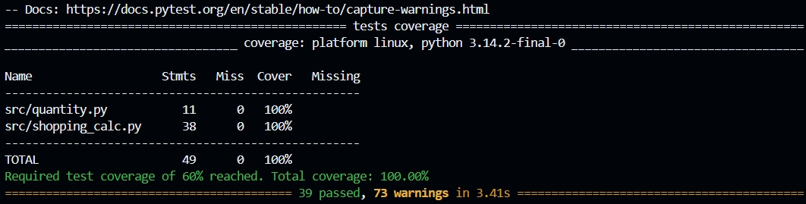

# Отчёт о покрытии тестами (ЛР-7)

Команда запуска: `python -m pytest` (настройки в `pytest.ini`),
подробный режим: `python -m pytest --cov-report=term-missing -v`.

Ключевая вычислительная логика: `shopping_calc` (агрегация списка
покупок) и `quantity` (разбор количества). Порог по методичке — 60%,
зафиксирован в конфигурации запуска (`--cov-fail-under=60`); тесты
падают, если покрытие упадёт ниже порога.

## Результат последнего запуска

