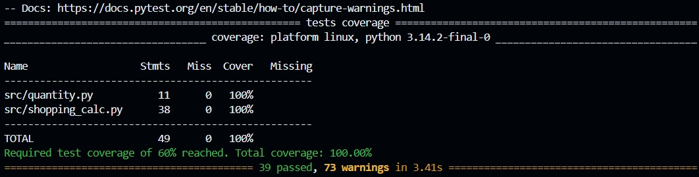

# Отчёт о покрытии тестами (ЛР-7)

Команда запуска: `python -m pytest` (настройки в `pytest.ini`),
подробный режим: `python -m pytest --cov-report=term-missing -v`.

Ключевая вычислительная логика: `shopping_calc` (агрегация списка
покупок) и `quantity` (разбор количества). Порог по методичке — 60%,
зафиксирован в конфигурации запуска (`--cov-fail-under=60`); тесты
падают, если покрытие упадёт ниже порога.

## Результат последнего запуска

```
--------------- tests coverage -----------------------------------------------
______________ coverage: platform win32, python 3.10.11-final-0 _______________

Name                   Stmts   Miss  Cover   Missing
----------------------------------------------------
src\quantity.py           11      0   100%
src\shopping_calc.py      38      0   100%
----------------------------------------------------
TOTAL                     49      0   100%
Required test coverage of 60% reached. Total coverage: 100.00%
```


